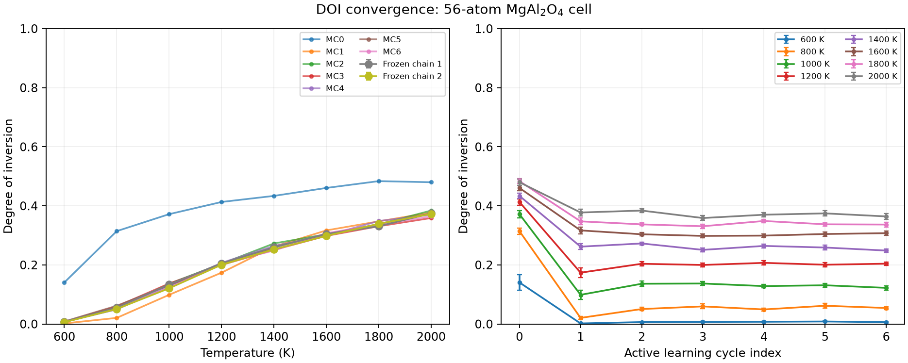

# 検証記録

[入門チュートリアル](../README.ja.md) · [English](validation.md)

## 環境と検証範囲

Python 3.12.16、PyTorch 2.8.0+cu126、TorchSim 0.6.0、Orb 0.7.0、ASE 3.29.0、
mpi4py 4.1.2とNVIDIA RTX 6000 AdaのGPU 1枚で確認しています。
追加パッケージの版は`../requirements-torchsim.txt`に指定し、abICS本体の依存関係には
追加していません。

以前の単体チュートリアルではænet 2.0.4を使用しました。本家のexampleとしては、
本家ænet 2.0.5（CMake、シリアル版）でも追加確認しています。このビルドでの名前は
`generate.x_serial`、`train.x_serial`、`predict.x_serial`です。
CMakeの指定によって接尾辞が変わるため、`input.toml`には`aenet/build/bin`に
実際に生成されたプログラムを指定してください。

## 本家への組み込み確認

2026-11-12に、abICS developのチェックアウト上のexampleを、本家ænetのコミット
`8f35990f5e3dd6cb296b953448cb11694d0cff3d`（2.0.5、CMake、GNU Fortran 12.3）で
最初から2サイクル実行しました。参照計算80件がすべて収束し、格子へのマッピングにも
成功しました。8レプリカ・各6,400ステップのMonte Carlo計算が両方完了し、8温度の
有限値の結果と各レプリカ400サンプルを確認しています。ASE版も56原子の2入力でCPU上の
収束を確認しました。モデルの重みはローカルファイルを読み込んでいます。

abICSのユニットテストは60件中、未導入のNequIP関連5件をスキップして成功しました。
example用の6テストも追加パッケージありで成功しています。追加パッケージなしでは
DOIのテストが成功し、TorchSim用の5件がスキップされます。
日英コマンドの一致、相対リンク、シェル構文も確認しました。

`abics_gen_aenet_input input.toml`による入力生成も確認しました。生成された記述子と
訓練設定は以前同梱していたテンプレートと一致し、予測入力ではAlとMgがソート順に並びます。
生成した入力を使い、検証済みのAL0の参照40構造をすべてマッピングでき、本家ænet 2.0.5で
500回の訓練と、その後の有限値のエネルギー予測を確認しました。入力生成の単体テスト3件も
成功しました。この確認では参照構造を再利用し、Orbによる緩和とMonte Carlo計算は
再実行していません。

## バッチ緩和の確認

同じ56原子の8構造でバッチ推論と個別推論を比較し、エネルギーの最大差は
1.53 × 10⁻⁵ eV、力の成分の最大差は2.98 × 10⁻⁶ eV/Åでした。
保存した緩和後の80構造をASE側で独立に再評価したエネルギーは、保存値との差が
最大3.05 × 10⁻⁵ eVでした。

同じ8構造・モデル・精度・セルフィルター・最適化条件でウォームアップし、実行順を
交互にして各3回測定しました。中央値はバッチサイズ1で10.064秒、8で1.939秒で、
5.19倍の高速化でした。モデルロードとファイルI/Oは含みません。この条件に対する実測であり、
別のモデル版との比較や、どの計算機でも同じ高速化率を得られるという意味ではありません。
40構造のバッチ緩和でPyTorchが割り当てたGPUメモリの最大値は0.747 GiBでした。
CUDA contextなどのPyTorch管理外の領域は含みません。

意図的に最適化を途中で打ち切ると、非ゼロで終了し、入力構造を保持して、未収束の
両構造に`energy.dat`を生成しないことを確認しました。ユニットテストでは、成功・失敗が
混ざったバッチ、非有限値、既存出力の保護、不正な収束基準、DOIの計算も確認します。
TorchSimが必要なテストは、追加依存関係がない環境ではスキップします。

## DOIの収束確認

以前の56原子セルの検証では7回のactive learningサイクル、参照計算280件を実行しました。
すべて緩和が収束し、格子へのマッピングにも成功しています。追加サイクルは各レプリカ
25,600 MCステップとMPI版ænetでの訓練を使いました。全8温度のDOIの最大変化は、
直近3回で0.01781、0.01250、0.01031でした。

事前に、連続3更新で変化が0.02以内、直近4モデルの相関を考慮した標準誤差が0.01以内と
定めました。モデルを固定し、異なる2つの乱数seedで独立検証を行っています。
最初の25,600ステップでは1,600 Kの差が0.02141だったため、両方を各レプリカ51,200
ステップへ延長しました。最終的な2本の最大差は0.01320で、平均と最後の学習サイクルの
差は最大0.00953でした。各系列の標準誤差の最大値は0.00537と0.00595、
合成した標準誤差の最大値は0.00388でした。

温度交換履歴から各温度のDOI時系列を復元し、最初の半分を除外しました。
最低8ブロックを残す範囲でブロックサイズを1,2,4,...と変え、ブロック平均の標準誤差の
最大値を採用しています。保持した系列の前半・後半の整合性と温度の往復回数も確認しました。

| 温度（K） | DOI平均 | 合成標準誤差（相関を考慮） |
| --- | --- | --- |
| 600 | 0.00668 | 0.00084 |
| 800 | 0.05320 | 0.00328 |
| 1000 | 0.12746 | 0.00388 |
| 1200 | 0.20277 | 0.00357 |
| 1400 | 0.25652 | 0.00327 |
| 1600 | 0.30164 | 0.00309 |
| 1800 | 0.33504 | 0.00303 |
| 2000 | 0.37375 | 0.00348 |

これは、このセル・UMLP・on-latticeモデルに対する操作的な確認です。セルサイズ依存性、
UMLP自体の正確さ、実験との一致を確認したものではありません。入門手順の2サイクルは
実行手順の例であり、収束済みの参照曲線ではありません。

