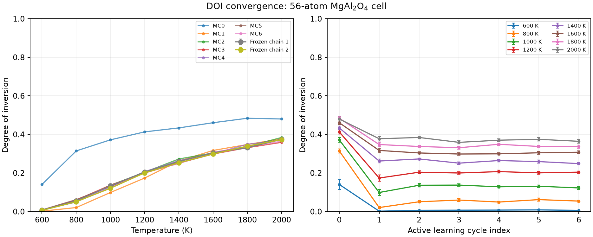

# Validation record

[Beginner tutorial](../README.md) · [日本語](validation.ja.md)

## Environments and scope

The examples were checked with Python 3.12.16, PyTorch 2.8.0+cu126,
TorchSim 0.6.0, Orb 0.7.0, ASE 3.29.0, mpi4py 4.1.2, and one NVIDIA RTX 6000
Ada GPU. Optional version constraints are in `../requirements-torchsim.txt`.
The example's dependencies are not added to abICS's base installation.

An earlier standalone calculation used ænet 2.0.4. The upstream example is
additionally checked with upstream ænet 2.0.5 (CMake, serial executables).
The output names in this build are `generate.x_serial`, `train.x_serial`, and
`predict.x_serial`. Other CMake options can produce different suffixes.
Use the actual executables in `aenet/build/bin` when editing `input.toml`.

## Upstream integration check

On 2026-11-12, the example in the abICS develop checkout was run end to end
against upstream ænet commit `8f35990f5e3dd6cb296b953448cb11694d0cff3d`
(version 2.0.5), built with CMake and GNU Fortran 12.3. All 80 references across
two cycles converged and mapped successfully. Both eight-replica, 6,400-step
Monte Carlo runs completed, producing finite 8-temperature result tables and
400 saved samples per replica. The ASE alternative also converged on two
56-atom inputs on CPU. Model weights were read from a local checkpoint.

The abICS unit suite passed: 60 tests, with five unavailable NequIP tests
skipped. The six example tests passed with its optional packages installed;
without those packages, the observer test passed and the five TorchSim tests
skipped. Bilingual command parity, relative links, and shell syntax were also
checked.

The ænet input-generation step was also checked with
`abics_gen_aenet_input input.toml`. Generated descriptor and training settings
match the former bundled templates; the prediction file lists Al and Mg in
sorted order. Using these generated files, all 40 previously validated AL0
reference structures mapped successfully, upstream ænet 2.0.5 completed 500
training iterations, and a subsequent energy prediction was finite. The three
input-generator unit tests also passed. This check reused reference structures
and did not repeat the Orb relaxations or Monte Carlo runs.

## Batched relaxation checks

On eight identical 56-atom inputs, compared with individual inference, the
maximum energy difference was 1.53 × 10⁻⁵ eV and the maximum force-component
difference was 2.98 × 10⁻⁶ eV/Å. Independent ASE reevaluation of 80 saved relaxed
structures differed from their saved energies by at most 3.05 × 10⁻⁵ eV.

A warmed benchmark used the same eight structures, model, precision, cell
filter, and optimizer. Three repeats in alternating order gave median times of
10.064 s for batch size 1 and 1.939 s for batch size 8 (5.19× speedup).
Model loading and file I/O were excluded. These are workload-specific timings,
not a comparison between different model versions or an expected speedup on
all hardware. Peak PyTorch-allocated memory in the 40-structure batched run was
0.747 GiB, excluding CUDA context and other non-PyTorch allocations.

An intentionally truncated optimization returned nonzero, preserved the input
structures, and wrote no `energy.dat` for either unconverged structure. Unit
tests also exercise mixed successful/failed batches, non-finite results,
existing-output protection, invalid tolerances, and the DOI observer. Tests
requiring TorchSim skip when those optional dependencies are absent.

## DOI convergence

The earlier 56-atom-cell study completed seven active learning cycles and
280 reference calculations. All reference relaxations converged and mapped
onto the lattice. Additional cycles used 25,600 MC steps per replica and
MPI ænet training. The last three maximum DOI changes across all eight
temperatures were 0.01781, 0.01250, and 0.01031.

The preselected criteria required changes <=0.02 for three consecutive updates
and correlation-aware standard errors <=0.01 in the last four models.
For independent validation, the model was frozen and two different random
seeds were used. An initial 25,600-step check differed by 0.02141 at 1,600 K,
so both runs were extended to 51,200 steps per replica. The final maximum
between-chain difference was 0.01320; the mean differed from the last active
learning cycle by at most 0.00953. Maximum per-chain blocked standard errors
were 0.00537 and 0.00595. The maximum combined standard error was 0.00388.

Temperature histories were used to reconstruct each temperature's DOI series.
The first half was discarded. The standard error was the largest batch-means
estimate over dyadic block sizes retaining at least eight blocks. Retained-half
stationarity and cold–hot–cold round trips were also checked.

| Temperature (K) | Mean DOI | Combined blocked SE |
| --- | --- | --- |
| 600 | 0.00668 | 0.00084 |
| 800 | 0.05320 | 0.00328 |
| 1000 | 0.12746 | 0.00388 |
| 1200 | 0.20277 | 0.00357 |
| 1400 | 0.25652 | 0.00327 |
| 1600 | 0.30164 | 0.00309 |
| 1800 | 0.33504 | 0.00303 |
| 2000 | 0.37375 | 0.00348 |

These are operational checks for this cell, UMLP, and on-lattice model.
They do not establish convergence with cell size, the accuracy of the UMLP,
or agreement with experiment. Two cycles in the beginner guide demonstrate
execution and are not a converged reference curve.

